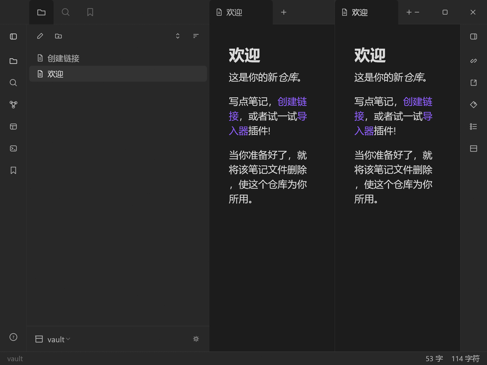

# ObsidianCraft — your notes, as plain Markdown, in a vault you own

<p align="center">
  
</p>
<p align="center"><sub>ObsidianCraft: a local vault, [[wiki links]], split editing and a status bar</sub></p>

[](LICENSE)
[](#status)
[](https://github.com/storytold/craft-anything)

**English (default)** · [简体中文](README.zh-CN.md)

> **Work in progress.** The rebuild runs and its checks are being closed one at a time; some screens
> and behaviours are still being finished. Treat this as a preview, not a release.

> **Notes are files, not a service.**
> ObsidianCraft keeps a folder of Markdown files as a vault, with wiki-style links, backlinks,
> search, tabs and a graph — no account, no cloud, no lock-in.

- 📝 **Editor** — Markdown editing with live preview, tabs and the usual shortcuts
- 🔗 **Links** — `[[wiki links]]`, backlinks and unresolved-link handling
- 🕸 **Graph** — a force-directed map of the vault, zoomable and pannable
- 🔍 **Search and quick switcher**
- 📁 **Local vaults** — one or more vaults, side by side

## Build and run

Requires Rust (edition 2021) and, on Windows, the MSVC toolchain.

```sh
cargo run --release
```

Set `OBSIDIANCRAFT_VAULT` to open a vault folder directly.

## Status

Work in progress: the app builds and draws, and the rebuild's checks are being closed one at a time.
Everything here is a study reimplementation of behaviour — no code, assets, icons or text from any
commercial program is included.

## Credits

Built with [Craft Anything](https://github.com/storytold/craft-anything), the clean-room engine that
shows how software works and then builds your own version of it.

A community app of the [ArtCraft](https://getartcraft.com/) family — [www.mengbot.com.cn](https://www.mengbot.com.cn).

This is an independent project. It is not affiliated with, endorsed by, or connected to the authors
of any commercial program it was studied from.

## License

MIT — see [LICENSE](LICENSE).
