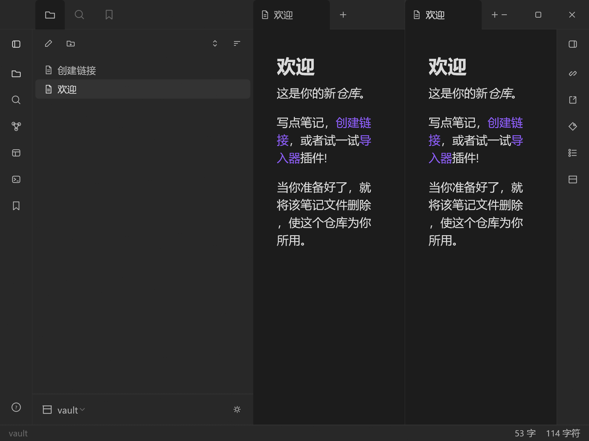

# ObsidianCraft — 笔记就是 Markdown 文件，放在你自己的仓库里

<p align="center">
  
</p>
<p align="center"><sub>ObsidianCraft：本地仓库、[[双链]]、分栏编辑与状态栏</sub></p>

[](LICENSE)
[](#状态)
[](https://github.com/storytold/craft-anything)

[English (default)](README.md) · **简体中文**

> **开发中（WIP）。** 复刻版可以运行，检查项正在逐条收尾；部分界面和行为仍在完善。请当作预览版而不是正式发布。

> **笔记是文件，不是服务。**
> ObsidianCraft 把一个装着 Markdown 文件的文件夹当作仓库，支持 wiki 双链、反向链接、搜索、标签页和关系图——无账号、无云、不锁定。

- 📝 **编辑器** —— Markdown 编辑 + 实时预览、标签页与常用快捷键
- 🔗 **链接** —— `[[wiki 双链]]`、反向链接与未解析链接提示
- 🕸 **关系图** —— 力导向的仓库地图，可缩放、可拖动
- 🔍 **搜索与快速切换**
- 📁 **本地仓库** —— 可同时打开一个或多个仓库

## 构建与运行

需要 Rust（2021 edition），Windows 上需要 MSVC 工具链。

```sh
cargo run --release
```

设置 `OBSIDIANCRAFT_VAULT` 环境变量可直接打开某个仓库目录。

## 状态

开发中：应用可编译、可启动、可绘制，检查项正在逐条通过。这里是对行为的学习性重新实现——不包含任何商业程序的代码、素材、图标或文本。

## 致谢

使用 [Craft Anything](https://github.com/storytold/craft-anything) 构建——看清软件如何工作，然后做出你自己的版本。

[ArtCraft](https://getartcraft.com/) 家族社区应用 —— [www.mengbot.com.cn](https://www.mengbot.com.cn)。

本项目为独立项目，与原程序的作者无隶属或关联关系。

## 许可证

MIT —— 见 [LICENSE](LICENSE)。
